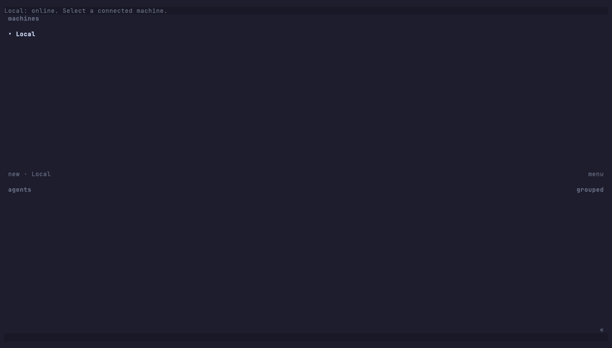

# herdr-folders

A [herdr](https://herdr.dev) plugin that adds a folder sidebar. Every terminal and agent is grouped under its folder (the git repo root, or the cwd). Each folder shows a git line like the `minimal-git` zsh prompt. You can bulk close panes from the sidebar, and a VS Code-style git changes panel opens from any folder.



<sub>Recorded on temp folders and temp git repos, in an isolated herdr server, with opencode agents
on a free local model. Re-record it with the [`herdr-folders-demo` skill](skills/herdr-folders-demo/SKILL.md).</sub>

## Features

- **Replaces herdr's sidebar:** `replace on` hides herdr's own sidebar (through two managed lines
  in `config.toml`) and shows this panel on the left. It is one panel for all tabs, like herdr's:
  when you switch tabs (in the same workspace or another), the same panel process moves to the tab
  you see, with its state. Every other tab holds a light placeholder at the left that shows the
  panel's last frame at the same width, so a tab looks right at once and the move is one
  `pane move` plus one `pane close`. The `↶` button
  (or `R`, or `replace off`) restores herdr's sidebar and closes the panels.
- **Projects tab (optional):** when [herdr-project-manager](https://github.com/barnuri/herdr-project-manager)
  is installed, a second tab lists its projects, using its own globs and excludes. Type to filter,
  press `enter` to open a project as a workspace (or focus it when it is already open), and
  right-click or press `ctrl+t` to open it as a tab. Open projects show their status dot.
  Turn the tab off with `projects-tab off`.
- **Focused pane marked:** the pane you are in gets an accent bar and bold text, and its folder name
  turns blue, like the selected row in herdr's sidebar.
- **Two groupings:** flat, one group per folder (default), or a tree that nests folders by path,
  with single-child directories merged (`sandbox/private`). Toggle with the toolbar button, `v`, or
  `grouping tree|folder`.
- **Right-click menus:** right-click an agent or shell to focus it, close it (asks first), open a
  new tab in its folder, or see git changes. Right-click a folder for new tab, git changes, and
  close all of its panes.
- **Folder cards:** each folder group (its head, git line, agents and shells) sits on its own card
  colour, alternating blue-grey and plum, with a stripe in the folder's colour down its left edge,
  so you can see where a folder starts and ends. Narrow panels (phones) drop the state words and
  keep the colour-coded icons.
- **Shells read like agents:** shell name (`zsh`, `bash`) or the running command, with `ready` or
  `running` on the right.
- **Easy targets:** every agent and shell is a two-row card (name, then its title or tab), and a
  click anywhere on the card works. The card under the pointer is highlighted. `s` or
  `spacing compact` goes back to one-row items.
- **New tab per folder:** the `+` at the end of a folder row opens a shell tab in that folder's
  workspace and focuses it (`n`, or `new-tab <folder>`).
- **Always expanded (optional):** `collapsible off` (or the actions list) removes the chevrons and
  the collapse buttons, and every folder stays open. A folder click then focuses its first pane.
- **Settings and actions:** the toolbar keeps only hide and the gear. The gear (or `?`) opens a list
  of every panel action with its icon and key: view, panel, folder and bulk close.
- **Folder tree:** one node per folder, with a type icon (rust, go, python, bun, typescript, node, java, helm, docker, agent, git, plain). Under it are its agents and terminals. A pane that runs an agent is shown once, as an agent.
- **herdr statuses:** agents show working (spinner), orch (spinner, magenta: the agent is idle but orch work it started is still running, with the orch summary under the card), blocked, done, idle and unknown. Terminals show `›` at the shell prompt, or `▶ <command>` while something runs. Folders show the most urgent status. Folders with active agents sort first.
- **Git line per folder:** `branch ↓behind ↑ahead +added ?untracked ±modified -deleted !conflicts`, or `=` when clean.
- **Toolbar buttons:** collapse all, expand all, expand all agents (tab, title, pane id), narrow, widen, hide to a strip, and bulk close.
- **Resize:** use the `−`/`+` buttons or `[`/`]`, or drag the `▕` grip on the left edge. The width is saved.
- **Bulk close (with confirmation):** close empty folders (every pane is an idle shell), close idle agents and empty folders, close all terminals (agents stay), close everything.
- **Git changes panel:** right-click a folder (or press `g`) to open a popup. It has staged and unstaged groups, a side-by-side diff with line numbers (`v` or the header button switches to unified), stage, unstage and discard per file or per group, commit, fetch, pull (`--ff-only`) and push.

## Install

```sh
herdr plugin link ~/sandbox/private/herdr-folders
node ~/sandbox/private/herdr-folders/bin/folders.js replace on
```

herdr applies `sidebar_start_collapsed` when a client attaches. If herdr's sidebar is still expanded
in the client that is open now, press your toggle-sidebar key (`prefix`, then `b`) once.
`replace off` removes the managed lines, so herdr's sidebar comes back as a rail that you can click
to expand.

## Sidebar keys

| Key | Action |
|---|---|
| `j`/`k`, arrows | move |
| `enter` | focus the pane, or toggle the folder |
| `space`, `←`/`→` | toggle the folder or the agent details |
| `g` / right-click | git changes for the folder |
| `e` / `c` / `a` | expand all / collapse all / toggle all agents |
| `x`, then `1`-`4` | bulk close menu |
| `[` / `]` | narrow / widen |
| `h` | hide to a strip / show |
| `tab` | switch between the Folders and Projects tabs |
| `?` / gear | all actions |
| `v` | flat or tree grouping |
| `s` | two-row or one-row items |
| `n` | new tab in the selected folder |
| `R` | restore herdr's sidebar (in replace mode) |

## Git panel keys

`s` stage or unstage · `d` discard (asks first) · `A`/`U` stage or unstage all · `c` type a commit message, `enter` to commit · `f` fetch · `p` pull · `P` push · `v` split or unified diff · `tab` move focus to the diff · `pgup`/`pgdn` scroll · `q` close.

## Control from an AI agent

Every feature is a CLI command that prints JSON. The CLI and the panel share `~/.local/state/herdr-folders/state.json`, so a command changes an open panel within 0.5 s.

```sh
node bin/folders.js snapshot                         # folders, panes, statuses, git
node bin/folders.js replace on|off                   # replace herdr's sidebar, or restore it
node bin/folders.js projects web --rescan            # project-manager projects, filtered
node bin/folders.js open-project web-shop [--tab]
node bin/folders.js view projects|folders
node bin/folders.js grouping tree|folder
node bin/folders.js spacing compact|comfortable
node bin/folders.js collapsible on|off
node bin/folders.js card-backgrounds on|off
node bin/folders.js new-tab ~/repo
node bin/folders.js collapse-all | expand-all | expand-agents | collapse-agents
node bin/folders.js close terminals                  # dry run: lists what would close
node bin/folders.js close idle-agents-and-empty-folders --yes
node bin/folders.js panel toggle|open|close|hide|show|grow 10|shrink 10|width 50
node bin/folders.js focus w1:p3
node bin/folders.js git-status ~/repo
node bin/folders.js git-diff ~/repo src/a.js [--staged]
node bin/folders.js git-action ~/repo stage src/a.js | commit "msg" | push
node bin/folders.js git ~/repo                       # open the git popup
```

The same operations are plugin actions (`herdr plugin action list --plugin barnuri.folders`). The close actions open a confirmation popup. `close` never closes the pane that runs the command.

## Limits

- herdr has no API to collapse its sidebar in a running client. `replace on` sets it for new
  clients and hides the collapsed rail at once. An expanded sidebar needs one key press.
- The first project scan can take minutes with broad globs (`**/.git`). The result is cached, the
  scan runs in the background, and it repeats every 10 minutes (`ctrl+r` in the tab starts one).
- herdr keeps panes at least about 18 columns wide, so the hidden strip shows status icons with short names.
- Drag-resize uses mouse motion inside the panel. Dragging toward the panel narrows it. To widen, use `+` or `]`, because herdr may not send motion events outside the pane.

## Development

```sh
npm test
```

An open sidebar keeps the code it loaded at start. After a code change, run `panel close` then `panel open`.
